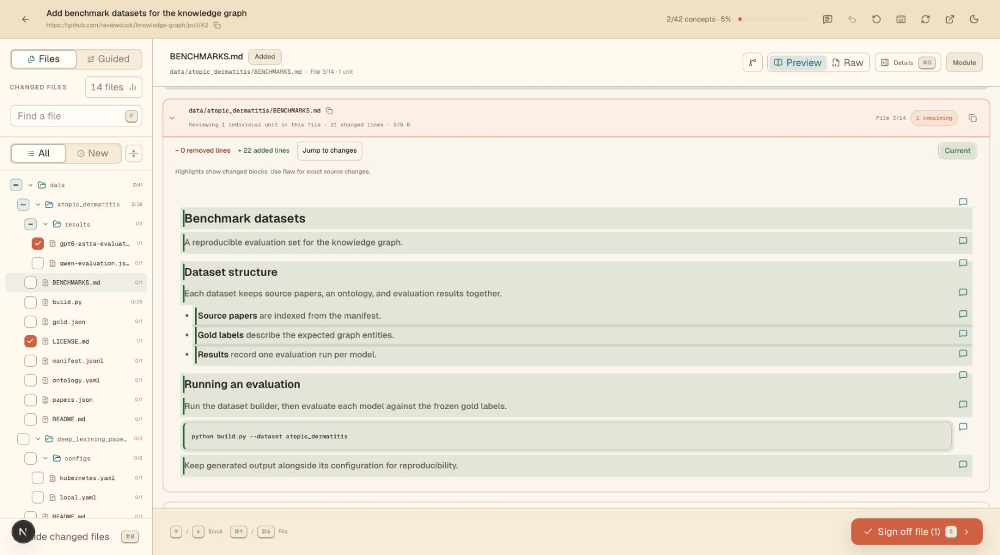
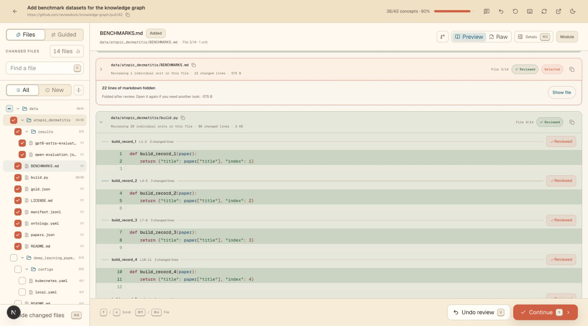
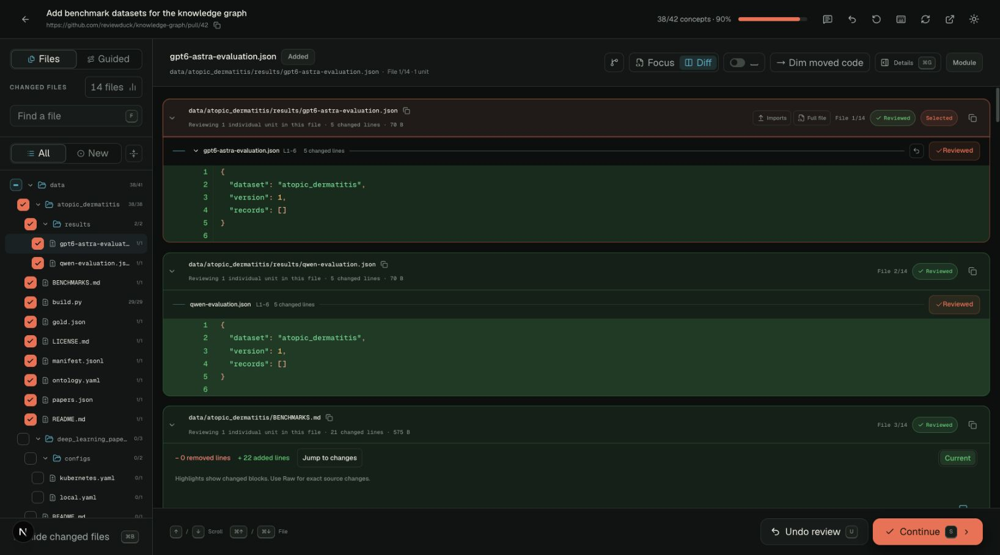
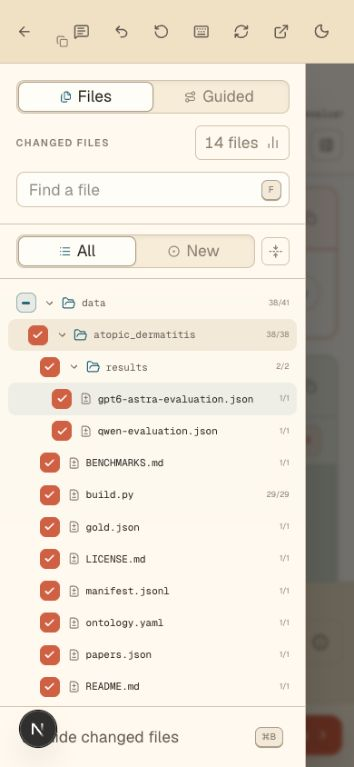

# Folder review

The changed-files sidebar has a checkbox beside each folder. Click it to sign
off outstanding review units in every nested file. Folder navigation remains
separate, so the checkbox works with the folder open or closed.

- An empty checkbox means no units are reviewed; a dash means partial progress
  or units waiting for a response; a check means the folder is fully reviewed.
- Clicking a checked folder returns its units to review. The toolbar's Undo
  also takes back a folder sign-off as one step, preserving earlier sign-offs.
- Search and the New filter limit the action to matching files. The tooltip
  describes that scope. Units waiting for a response and files without review
  units are left alone.
- Progress changes immediately. Saves use the existing queue in batches of up
  to 20 units, with individual rollback on failure. Folder enqueueing copies the
  pending set once instead of once per unit. Affected folder controls are
  disabled during saves; unrelated folders remain available.

Browser QA also found a pre-existing undo persistence bug: JavaScript truncated
PostgreSQL's microsecond sign-off timestamps before comparing them. Undo now
compares the original timestamps inside PostgreSQL, retaining the existing
lineage and event checks.

## Verification

`pnpm check` passes, including 3,240 unit tests. The PostgreSQL review-stats
integration suite passes all five tests, including a regression that failed
before the timestamp fix.

Chrome testing used the user's existing session with a local app, an isolated
PostgreSQL database, synthetic analyzed files, and a deterministic local provider
fixture. A folder with ten files and 38 units began with two units reviewed.
One click signed off the remaining 36 in two batch requests; siblings were
unchanged. Checking, returning, Undo, reload persistence, keyboard controls,
desktop layouts, and the mobile drawer were verified.

## Screenshots

Partial progress, with the folder structure intact:

After checking the folder:

The same controls in the dark theme:

The folder action in the mobile drawer:

